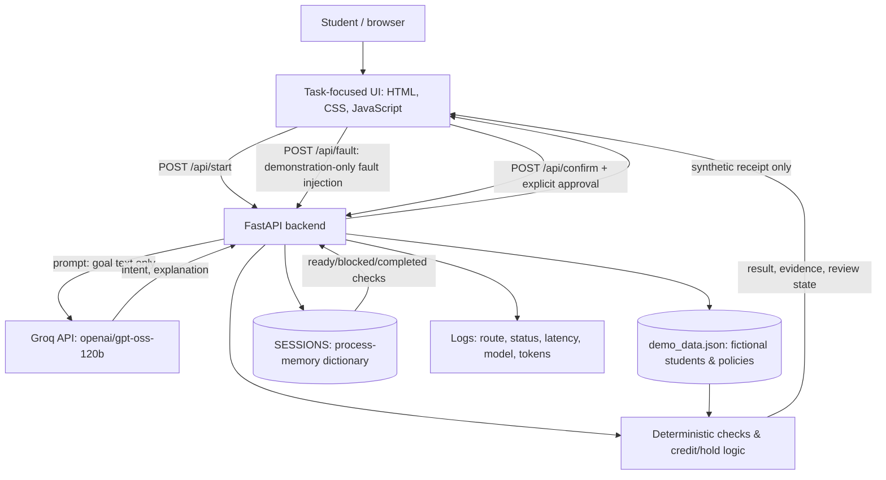

# InterfaceDNA — Checkpoint 3 Architecture and Data Flow

**Project:** InterfaceDNA | **Team:** Aabha Borle, Sakshi Katolkar, Anisha Kango  
**Snapshot:** November 2, 2026 | **Status:** Documented from available CP3 application source and demonstrated UI.

## System summary
InterfaceDNA converts a student's natural-language goal into a task-specific interface for three simulated academic workflows: course dropping (Alex), graduation readiness (Maya), and registration holds (Jordan). Real Groq-hosted model inference classifies the goal; deterministic Python rules calculate consequences from **fictional** student/policy records. The backend controls approval and records a **simulated** action receipt. No university system is modified.

## Architecture diagram

## Components and actual technologies
| Component | Current implementation | Limitations |
|---|---|---|
| Client | `app/index.html`, `app/assets/styles.css`, `live.css`, `live.js` | Requires server for dynamic workflows |
| Orchestrator | Python FastAPI in `app/server.py` | Runs locally; deployment not yet verified |
| AI model | Groq OpenAI-compatible endpoint, `openai/gpt-oss-120b` | Live provider availability/quota required |
| Prompts | `app/prompts/system.txt` and `settings.json` | Classification only; not an autonomous tool-using agent |
| Record source | `app/demo_data.json` | Synthetic file, not a database |
| Session state | In-memory `SESSIONS` protected by `Lock` | Lost on restart; not shared across workers |
| Actions | `/api/confirm` enforces review state and explicit confirmation | Returns synthetic receipt; no university action |
| Fault injection | `/api/fault` switches between `none`, `policy_conflict`, `missing_record`, `service_outage` | Simulated faults rather than real provider outages |
| Observability | Python logging middleware and model token usage | No stored monitoring dashboard or computed dollar cost |

## Main request flow
1. Student selects a fictional persona and types a question.
2. Browser calls `POST /api/start`.
3. Backend sends **the question**, not the full student record, to Groq; checks returned intent against `drop`, `graduation`, `hold`, `unknown`.
4. Backend reads `demo_data.json` and calculates a deterministic result with policy attribution.
5. Backend creates a session and returns `review` or `blocked` state; browser renders task cards.
6. Explicit confirmation calls `POST /api/confirm`; backend rechecks readiness and emits a **synthetic** receipt. Reconfirmation is rejected.
7. For the demo, fault dropdown calls `POST /api/fault` on the active session. Conflicts/outages/missing records block confirmation; clearing the injected fault revalidates the current session.

## Design choice: no vector database yet
The current dataset is a small, structured, controlled JSON corpus and does not require embedding-based semantic retrieval. A relational database such as SQLite is a **recommended future improvement** for durable sessions, receipts and richer record queries, not a feature that should be claimed as implemented. A vector store is optional only if the team later adds document-scale retrieval.

## Open issues to disclose
- The synthetic course-drop policy deadline in sample data is September 30, 2026; implement date enforcement or clearly anchor the classroom scenario to a simulated pre-deadline date before the demo.
- Maya's graduation requirements appear as JSON-like strings in some cards; render `name`, `status`, `detail` fields separately.
- Current approval does not change course enrollment or clear holds; label its meaning precisely.
- Production-grade authentication, request quotas, durable storage, and external integrations are out of scope for this snapshot.
